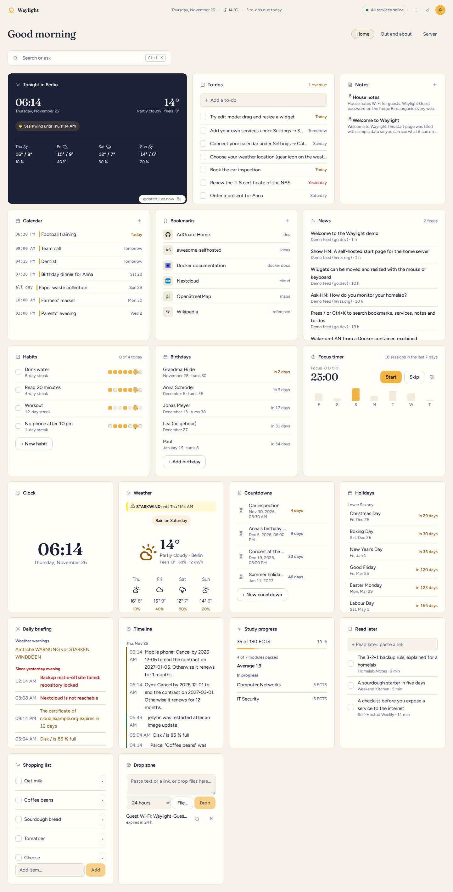
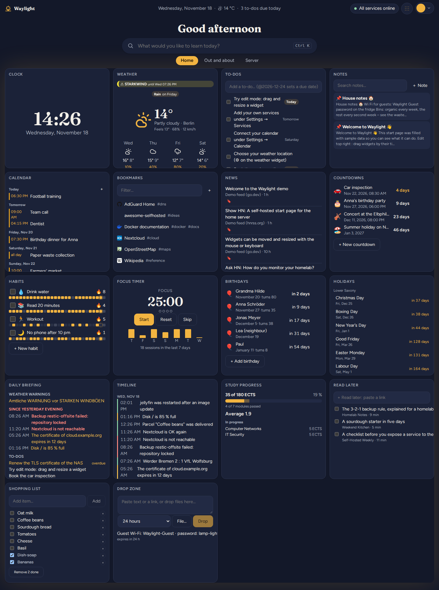
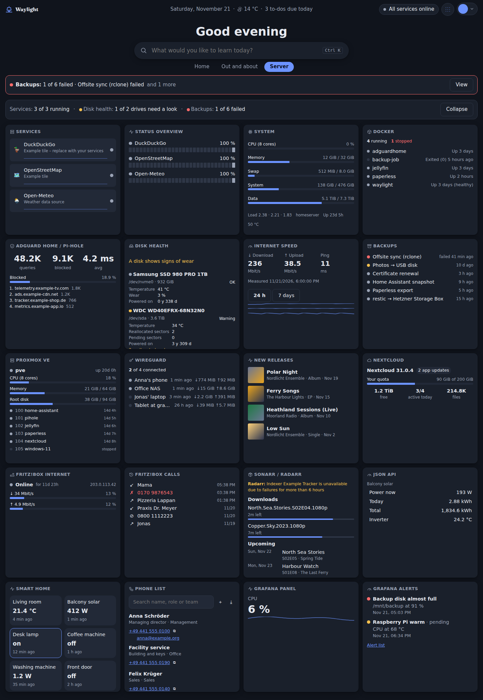
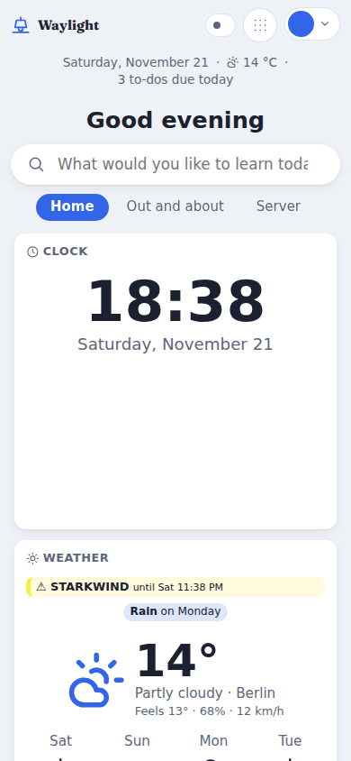
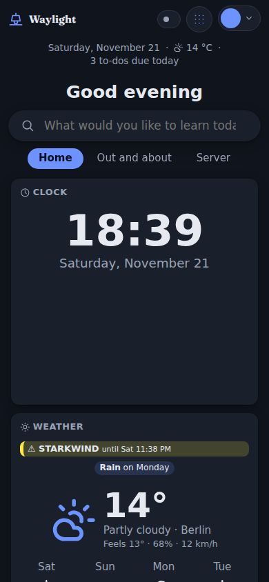

# trisse-home

[](https://github.com/itadori26/trisse-home/actions/workflows/ci.yml)

A self-hosted start page in the spirit of iGoogle. Arrange widgets on tabs:
the weather, your calendar, to-dos and the next train next to the state of
your home server, its containers and its backups. It runs as one small
program with an SQLite database, on a home server, a NAS or a Raspberry Pi.

- **Lean.** One binary with the web interface built in, a container image
  under 9 MB and about 75 MB of memory when idle. CI enforces these budgets
  ([ADR 0011](docs/adr/0011-lean-by-default.md)).
- **Private by default.** Sign-in with two-factor authentication or
  passkeys, a network allow-list, no telemetry, and no outside request
  except to the services you configure
  ([outbound requests](docs/outbound-requests.md)).
- **Least privilege.** Read-only Docker access, no WireGuard keys in the
  container, and every action that changes another system is off until you
  list exactly what may be changed ([security model](docs/security-model.md)).
- **Modular.** About 50 modules, from notes and habits to Proxmox, Home
  Assistant and Jellyfin, and each one can be switched off
  ([features](docs/features.md)).



<details>
<summary>More screenshots (dark mode, server tab, mobile)</summary>

| Dark mode                                                        | Server tab                                                                                       |
| ---------------------------------------------------------------- | ------------------------------------------------------------------------------------------------ |
|  |  |

| Mobile (light)                                                  | Mobile (dark)                                                 |
| --------------------------------------------------------------- | ------------------------------------------------------------- |
|  |  |

The screenshots are taken from a demo instance with every release
([demo mode](docs/demo.md)).

</details>

## Quick start

With Docker and the Compose plugin:

```sh
git clone https://github.com/itadori26/trisse-home.git
cd trisse-home
cp .env.example .env
sed -i "s|^SECRET_KEY=.*|SECRET_KEY=$(openssl rand -base64 32)|" .env
sudo docker compose up -d
sudo docker compose logs trisse-home | grep setup_token
```

Open `http://<server-ip>:8090`, enter the setup token and choose a password.
[Getting started](docs/getting-started.md) explains each step and what to
secure first.

No Docker? There is a [Debian package](docs/native-install.md) that runs as a
hardened systemd service, and a [Raspberry Pi image](docs/raspberry-pi.md)
you flash with Raspberry Pi Imager and that updates itself.

## Documentation

The [documentation](docs/index.md) is organised by what you want to do:

- **Deciding:** [what trisse-home is and is not](docs/about.md),
  [features](docs/features.md), [comparison with Homarr, Homepage, Glance
  and Dashy](docs/comparison.md), [FAQ](docs/faq.md)
- **Using:** [first steps](docs/first-steps.md),
  [tabs and widgets](docs/dashboard.md), [search](docs/search.md),
  [accounts, guests and kiosk displays](docs/accounts.md)
- **Running:** [configuration](docs/configuration.md),
  [backups](docs/backups.md), [updates](docs/updates.md),
  [host integrations](docs/host-integrations.md),
  [notifications](docs/notifications.md), [reverse proxy](docs/reverse-proxy.md)
- **Developing:** [development setup](docs/development.md),
  [developer guide](docs/developer-guide.md),
  [architecture](docs/architecture.md), [decision records](docs/adr/README.md)

## Contributing

Contributions are welcome. [CONTRIBUTING.md](CONTRIBUTING.md) covers the
setup, the rules for pull requests, new modules and translations. Planned
work is on the [roadmap](ROADMAP.md), changes per version in the
[releases](https://github.com/itadori26/trisse-home/releases). Questions and
ideas go to [Discussions](https://github.com/itadori26/trisse-home/discussions).
Please follow the [Code of Conduct](CODE_OF_CONDUCT.md), and report security
problems as described in [SECURITY.md](SECURITY.md).

## Licence

[MIT](LICENSE) for everything outside `ee/`. The directory [`ee/`](ee/README.md)
is reserved for team features and uses the
[Fair Core License](ee/LICENSE.md): source available, free to use except for a
competing offer, MIT after two years.
