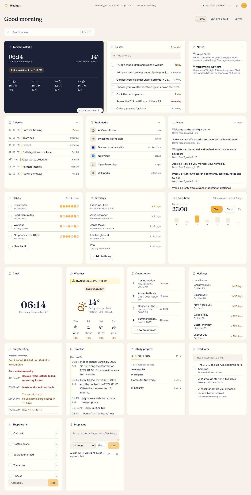

# Waylight documentation

Waylight is a self-hosted start page for one person and, if you like, the
people they share a home with. You arrange widgets on tabs: the weather, your
calendar and to-dos next to the state of your home server, its containers and
its backups. It runs as a single small program with an SQLite database, on a
home server, a NAS or a Raspberry Pi.

## Where to start

**You are wondering whether it fits your needs.** Read
[what Waylight is and is not](about.md) and the
[comparison with Homarr, Homepage, Glance and Dashy](comparison.md). The
[feature overview](features.md) lists every module.

**You want to install it.** [Getting started](getting-started.md) helps you
pick between Docker Compose, the Debian package and the ready-made Raspberry
Pi image, and walks you through the first login. Afterwards,
[first steps](first-steps.md) shows you around the dashboard in about ten
minutes.

**You already use it.** The user guide covers the [dashboard](dashboard.md),
[search and quick capture](search.md), [accounts, guests and kiosk
displays](accounts.md), [appearance](appearance.md) and
[the app on phones and offline](apps-and-offline.md).

**You run the server.** See [configuration](configuration.md),
[backups](backups.md), [updates](updates.md),
[host integrations](host-integrations.md) such as WireGuard and Proxmox,
[notifications](notifications.md) and the [security model](security-model.md).

**You want to contribute code.** Start with the
[development setup](development.md), then build a widget with the
[developer guide](developer-guide.md). The [architecture](architecture.md)
page and the [decision records](adr/README.md) explain why the code looks the
way it does.

## Getting help

Questions and ideas belong in
[GitHub Discussions](https://github.com/itadori26/waylight/discussions),
bugs in the [issue tracker](https://github.com/itadori26/waylight/issues).
Please report security problems privately, as described in the
[security policy](https://github.com/itadori26/waylight/blob/main/SECURITY.md).
